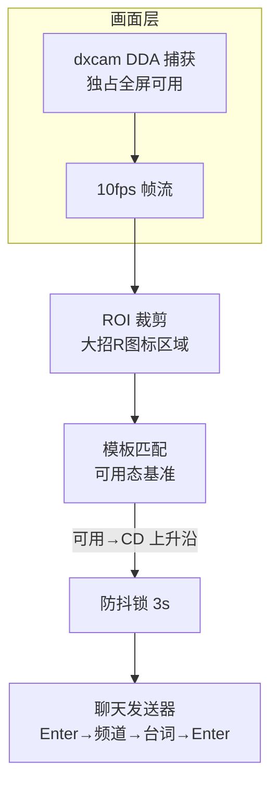

# 300 Shout 🦞

300英雄「开大招自动公屏喊话」工具。纯图像识别方案：**零进程接触、零内存读写、零注入**，反作弊视角下与真人操作无异。

[](https://github.com/yehuoshun/300-shout/actions/workflows/ci.yml)

## 功能

- 检测大招（R 技能）施放瞬间：技能图标从「可用态」变为「CD 态」的上升沿
- 自动打开聊天框发送台词（支持频道切换序列配置）
- 台词池随机 + 随机发送间隔，防机械节奏
- 一键标定：框选大招图标区域，自动采集基准图并写入配置
- 控制台 + 文件日志（`logs/`，按大小轮转）

## 技术方案



| 层 | 文件 | 说明 |
|----|------|------|
| 画面 | `capture.py` | dxcam(DDA) 抓独占全屏，失败自动回退 mss |
| 检测 | `detect.py` | matchTemplate 双基准(可用/CD) + 上升沿 + 防抖 |
| 发送 | `sender.py` | 模拟键盘聊天链路，频道序列可配置 |
| 标定 | `calibrate.py` | 截图 → 框选大招图标 → 采集基准 → 写配置 |
| 日志 | `logsetup.py` | 控制台 + 文件（`logs/`，2MB 轮转 ×3） |
| 入口 | `main.py` | 主循环：捕获→检测→触发→发送 + 日志 |

## 快速开始

```bash
pip install -r requirements.txt      # Windows 自动带上 dxcam / pydirectinput
```

**1. 标定（一次性）**

```bash
python calibrate.py
```

1. 游戏进自定义/训练模式，放大招
2. 全屏截图弹出后，鼠标框选**大招图标**（技能栏 R 槽）
3. 分别在大招「可用」和「CD 中」截图，按提示存为基准图
4. 自动写入 `refs/` 与 `config.json` 的 `roi`

**2. 运行**

```bash
python main.py
```

触发条件满足时自动喊话，日志写入 `logs/`。

**3. 启动自检（可选，不接触显示器/键盘）**

```bash
python main.py --self-test     # 离线跑通 配置→ROI→检测→发送→日志 整条链路
```

## 配置说明（config.json）

| 字段 | 说明 | 默认 |
|------|------|------|
| `capture.mode` | dxcam / mss | dxcam |
| `capture.fps` | 轮询帧率 | 10 |
| `roi` | 大招图标屏幕区域（标定自动写入） | - |
| `detect.threshold` | 可用态相似度阈值 | 0.8 |
| `detect.lock_seconds` | 触发后防抖锁 | 3.0 |
| `chat.open_key` | 打开聊天框按键 | enter |
| `chat.channel_keys` | 频道切换序列（见下） | [] |
| `chat.type_delay` | 逐字输入间隔 | 0.08 |
| `chat.enter_delay` | 按键间延迟 | 0.15 |
| `phrases` | 台词池（随机抽取） | - |
| `min/max_interval` | 触发间隔随机范围 | 1.5-3.0 |

### 频道切换（重要）

300英雄聊天频道切换方式**待实测**，`chat.channel_keys` 按实测填写：

| 实测结果 | channel_keys 值 |
|---------|----------------|
| 当前频道直发 | `[]` |
| Tab 切频道 | `["tab"]` |
| Shift+Enter 切全部 | `["shift+enter"]` |

> 组合键写作 `修饰键+主键`（如 `"shift+enter"`），内部走 `keyDown/keyUp` 包夹。
> 注意 `["shift", "enter"]` 是**两个独立按键**，不是组合键。

## 文件结构

```text
300-shout/
├── main.py            # 入口：主循环 + 日志
├── capture.py         # 画面层：dxcam/mss
├── detect.py          # 检测层：模板匹配 + 上升沿
├── sender.py          # 发送层：聊天按键序列
├── calibrate.py       # 标定工具
├── logsetup.py        # 日志系统
├── config.json        # 全部可调参数
├── requirements*.txt  # 运行 / 测试依赖
├── refs/              # 标定生成的基准图（gitignore）
├── logs/              # 运行日志（gitignore）
├── tests/             # 冒烟测试（离线）
└── .github/workflows/ # CI
```

## 测试与 CI

```bash
pip install -r requirements.txt -r requirements-dev.txt
python -m pytest -q            # 12 个冒烟测试（离线）
python main.py --self-test     # 端到端启动自检
```

CI（`.github/workflows/ci.yml`）两个任务：

- **start-test**（ubuntu-latest）：编译检查 → 单元测试 → `--self-test` 启动自检
- **windows-deps**（windows-latest）：装真依赖（dxcam/pydirectinput）→ 导入检查 → 单测 → 自检

> CI 只验证「**能启动、逻辑正确**」；**真机（游戏内实际喊话）仍需人工实测**。

## 已知限制

- **分辨率**：标定后勿改分辨率/UI 缩放，改了需重新标定
- **漏检**：图标被特效遮挡偶尔漏一帧，无伤大雅
- **频道切换**：待实测确认（见上）
- **反派检测**：ROI 尺寸须 ≥ 基准图尺寸；过小会被判为不可靠并告警（提示重新标定）
- **反作弊**：图像方案零进程接触，但过于频繁喊话仍可能被系统禁言/举报——台词池随机 + 间隔已内置

## 合规说明

本工具仅做**画面识别 + 键盘模拟**，不读取/修改游戏内存，不注入任何模块。请遵守游戏服务条款，勿用于刷屏广告等滥用场景。
