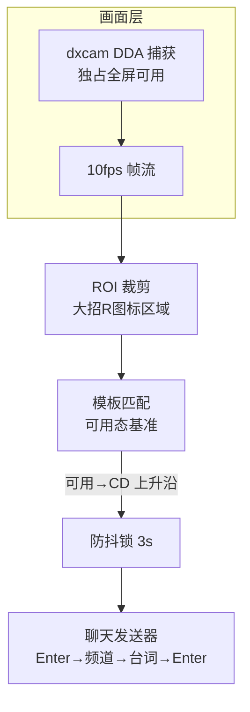

# 300 Shout 🦞

300英雄「开大招自动公屏喊话」工具。纯图像识别方案：**零进程接触、零内存读写、零注入**，反作弊视角下与真人操作无异。

## 功能

- 检测大招（R 技能）施放瞬间：技能图标从「可用态」变为「CD 态」的上升沿
- 自动打开聊天框发送台词（支持频道切换序列配置）
- 台词池随机 + 随机发送间隔，防机械节奏
- 一键标定：框选大招图标区域，自动采集基准图并写入配置

## 技术方案



| 层 | 文件 | 说明 |
|----|------|------|
| 画面 | `capture.py` | dxcam(DDA) 抓独占全屏，失败自动回退 mss |
| 检测 | `detect.py` | matchTemplate 双基准(可用/CD) + 上升沿 + 防抖 |
| 发送 | `sender.py` | 模拟键盘聊天链路，频道序列可配置 |
| 标定 | `calibrate.py` | 截图 → 框选大招图标 → 采集基准 → 写配置 |
| 入口 | `main.py` | 主循环：捕获→检测→触发→发送 + 日志 |

## 快速开始

```bash
pip install dxcam opencv-python numpy pydirectinput
```

**1. 标定（一次性）**

```bash
python calibrate.py
```

1. 游戏进自定义/训练模式，放大招
2. 全屏截图弹出后，鼠标框选**大招图标**（技能栏 R 槽）
3. 分别在大招「可用」和「CD 中」截图，按提示存为基准图
4. 自动写入 `config.json`

**2. 运行**

```bash
python main.py
```

触发条件满足时自动喊话，日志写入 `logs/`。

## 配置说明（config.json）

| 字段 | 说明 | 默认 |
|------|------|------|
| `capture.mode` | dxcam / mss | dxcam |
| `capture.fps` | 轮询帧率 | 10 |
| `roi` | 大招图标屏幕区域（标定自动写入） | - |
| `detect.threshold` | 可用态相似度阈值 | 0.8 |
| `detect.lock_seconds` | 触发后防抖锁 | 3.0 |
| `chat.open_key` | 打开聊天框按键 | enter |
| `chat.channel_keys` | 频道切换按键序列（见下） | [] |
| `chat.type_delay` | 逐字输入间隔 | 0.08 |
| `chat.enter_delay` | 按键间延迟 | 0.15 |
| `phrases` | 台词池（随机抽取） | - |
| `min/max_interval` | 触发间隔随机范围 | 1.5-3.0 |

### 频道切换（重要）

300英雄聊天频道切换方式**待实测**，`chat.channel_keys` 按实测填写：

| 实测结果 | channel_keys 值 |
|---------|----------------|
| 当前频道直发 | `[]` |
| Tab 切频道 | `["tab"]` |
| Shift+Enter 切全部 | `["shift","enter"]` |

## 文件结构

```text
300-shout/
├── main.py          # 入口：主循环 + 日志
├── capture.py       # 画面层：dxcam/mss
├── detect.py        # 检测层：模板匹配 + 上升沿
├── sender.py        # 发送层：聊天按键序列
├── calibrate.py     # 标定工具
├── config.json      # 全部可调参数
├── refs/            # 标定生成的基准图
└── logs/            # 运行日志
```

## 已知限制

- **分辨率**：标定后勿改分辨率/UI 缩放，改了需重新标定
- **漏检**：图标被特效遮挡偶尔漏一帧，无伤大雅
- **频道切换**：待实测确认（见上）
- **反作弊**：图像方案零进程接触，但过于频繁喊话仍可能被系统禁言/举报——台词池随机 + 间隔已内置

## 合规说明

本工具仅做**画面识别 + 键盘模拟**，不读取/修改游戏内存，不注入任何模块。请遵守游戏服务条款，勿用于刷屏广告等滥用场景。
