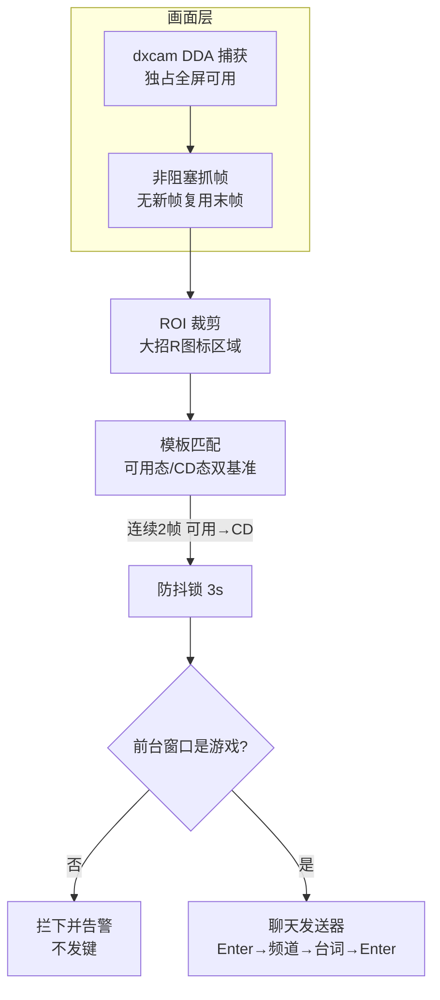

# 300 Shout 🦞

300英雄「开大招自动公屏喊话」工具。纯图像识别方案：**零进程接触、零内存读写、零注入**，反作弊视角下与真人操作无异。

[](https://github.com/yehuoshun/300-shout/actions/workflows/ci.yml)

## 功能

- 检测大招（R 技能）施放瞬间：技能图标从「可用态」变为「CD 态」的下降沿
- 自动打开聊天框发送台词（支持频道切换序列配置）
- 台词池随机（避免连续重复）+ 随机发送间隔，防机械节奏
- 一键标定：框选大招图标区域，自动采集基准图并写入配置
- 控制台 + 文件日志（`logs/`，按大小轮转）
- **安全护栏（v3）**：前台窗口校验（游戏不在前台绝不发键）、`--dry-run` 演练、F8/F9 全局热键

## 安全设计（v3 重点）

| 护栏 | 作用 | 开关 |
|------|------|------|
| 前台窗口校验 | 只有前台窗口标题命中白名单才发送；拿不到标题时**默认不发送** | `chat.require_foreground` / `--no-guard` |
| 演练模式 | 只打印「本应发送」的台词，**完全不碰键盘** | `python main.py --dry-run --stats` |
| 全局热键 | 误触发时一键停：F8 暂停/继续，F9 退出（不需要去点控制台） | `hotkeys` / `--no-hotkeys` |
| 多帧确认 | 连续 N 帧同向才切换状态，挡掉技能图标上的脉冲/粒子特效误判 | `detect.confirm_frames` |
| 防抖锁 | 触发后 N 秒内不再触发 | `detect.lock_seconds` |
| 统计输出 | 定时打印相似度分数，阈值不用靠猜 | `--stats 30` |

## 技术方案



| 层 | 文件 | 说明 |
|----|------|------|
| 画面 | `capture.py` | dxcam(DDA) 抓独占全屏，失败自动回退 mss；非阻塞 + 末帧缓存 |
| 检测 | `detect.py` | matchTemplate 双基准 + 多帧确认 + 下降沿 + 防抖，带 `status()` 观测 |
| 安全 | `guard.py` | 前台窗口标题校验 + 全局热键（纯 ctypes，无新依赖；非 Windows 安全降级） |
| 发送 | `sender.py` | 模拟键盘聊天链路；`unicode` / `clipboard` 两种输入法 |
| 标定 | `calibrate.py` | 截图 → 框选图标 → 采集基准 → 写配置；带 `--check` 体检 |
| 日志 | `logsetup.py` | 控制台 + 文件（`logs/`，2MB 轮转 ×3） |
| 入口 | `main.py` | 主循环：捕获→检测→守卫→发送 + 日志/统计/热键 |

## 快速开始

```bash
pip install -r requirements.txt      # Windows 自动带上 dxcam / pydirectinput
```

### 1. 标定（一次性）

```bash
python calibrate.py            # GUI 框选 + 采基准
python calibrate.py --check    # 体检：尺寸/纹理/两态可分性 + 建议阈值
```

1. 游戏进自定义/训练模式
2. 全屏截图弹出后，鼠标框选**大招图标**（技能栏 R 槽）。2K/4K 截图会先缩到 1600×900 预览，
   框选坐标自动换算回原分辨率（否则预览窗口比屏幕还大，边角拖不到）
3. 分别在大招「可用」和「CD 中」截图，按提示存为基准图
4. 自动写入 `refs/` 与 `config.json` 的 `roi`
5. **先跑 `--check`**：它会告诉你 ROI 与基准图尺寸是否一致、区域是否纯色无纹理、
   两种状态分不分得开、阈值该取多少——这些在游戏里都是「静默不触发」的常见原因

### 2. 先演练，再实战

```bash
python main.py --dry-run --stats 30    # 只检测不发送，每 30s 打印相似度
```

看两个数：放大招时（就在游戏里按 R，不用真等对局）

- `ready` 分数应明显高于 `cd` 分数，且跨过阈值 → 检测正常
- 若 `ready` 一直 ≈ 1.0 且从不掉下来 → 框选的区域没有 CD 变化，重新标定
- 若 `ready` 一直在阈值附近抖动 → `--stats` 的记录能看出该把阈值定在哪

确认检测正常后，先单独验证「发得出」（不用等真触发）：

```bash
python main.py --test-send "测试一下"    # 切到游戏，回车发出去应该能看到这句话
```

发得出来后实战：

```bash
python main.py                    # 默认每 60s 打印一次统计
python main.py --stats 30         # 自定义统计间隔
```

### 3. 运行中的热键

| 热键 | 动作 |
|------|------|
| F8 | 暂停 / 继续（暂停时仍响应 F9） |
| F9 | 立即退出 |

热键是轮询式的（`GetAsyncKeyState`），不装钩子、不起线程，进程退出后不留任何后台东西。
按住的键只算一次，松开再按才再次生效。可在 `config.json` 的 `hotkeys` 里改成别的键（支持 F1~F12/Esc/Space/Home/End/Insert/Delete）。

### 4. 启动自检（不接触显示器/键盘）

```bash
python main.py --self-test     # 离线跑通 配置→ROI→检测→守卫→热键→日志 整条链路
```

## 命令行参数

| 参数 | 说明 |
|------|------|
| `--dry-run` | 演练：只检测不发送（**真机首验必用**） |
| `--stats [SEC]` | 每 SEC 秒打印统计与相似度分数（默认 60） |
| `--frames N` | 处理 N 帧后退出（调试/短测） |
| `--no-guard` | 关闭前台窗口校验（**危险**，仅在自己确认窗口时用） |
| `--no-hotkeys` | 关闭全局热键 |
| `--list-windows` | 列出当前窗口标题，用来填 `chat.foreground_titles` |
| `--test-send TEXT` | 真机发送测试：把 TEXT 发进游戏（不抓屏、不用标定，守卫照常生效） |
| `--self-test` | 离线自检 |
| `--config PATH` | 指定配置文件 |
| `--log-level L` | 日志级别（默认 INFO） |
| `--version` | 版本号 |

## 配置说明（config.json）

配置文件里的键会与内置默认值**深合并**，老配置缺新键不会报错。

| 字段 | 说明 | 默认 |
|------|------|------|
| `capture.mode` | dxcam / mss | dxcam |
| `capture.output_idx` | 显示器序号 | 0 |
| `capture.fps` | 轮询帧率（主循环按此补足间隔，空闲时 CPU 占用很低） | 10 |
| `roi` | 大招图标屏幕区域（标定自动写入） | - |
| `detect.threshold` | 可用态相似度阈值 | 0.8 |
| `detect.lock_seconds` | 触发后防抖锁 | 3.0 |
| `detect.confirm_frames` | 连续多少帧同向才切换状态 | 2 |
| `chat.open_key` | 打开/发送聊天框按键 | enter |
| `chat.channel_keys` | 频道切换序列（见下） | [] |
| `chat.type_delay` | 逐字输入间隔 / 粘贴前延迟 | 0.08 |
| `chat.enter_delay` | 按键间延迟 | 0.15 |
| `chat.input_method` | `unicode`（逐字注入）或 `clipboard`（Ctrl+V） | unicode |
| `chat.require_foreground` | 是否校验前台窗口 | true |
| `chat.foreground_titles` | 前台窗口标题白名单（子串、大小写不敏感） | ["300英雄"] |
| `phrases` | 台词池（随机抽取） | - |
| `min/max_interval` | 触发间隔随机范围 | 1.5-3.0 |
| `hotkeys.pause/quit` | 暂停/退出热键 | f8 / f9 |
| `stats_interval` | 默认统计间隔（秒） | 60 |

### 前台窗口白名单

```bash
python main.py --list-windows     # 打印所有可见窗口标题
```

把游戏窗口标题里的稳定片段填进 `chat.foreground_titles`（例如 `"300英雄"`）。
白名单是**子串匹配**：填 `"300英雄"` 能命中 `"300英雄 - 客户端"`。

> 校验逻辑是「拿不到标题 = 不发送」（fail-closed）。所以如果游戏改用无标题的独占全屏窗口，
> 日志会持续出现「前台窗口 None 不在白名单」，此时需要先把 `--dry-run --stats` 跑一遍，
> 确认标题后再调整（或临时 `--no-guard`，但请清楚风险）。

### 频道切换（重要）

300英雄聊天频道切换方式**待实测**，`chat.channel_keys` 按实测填写：

| 实测结果 | channel_keys 值 |
|---------|----------------|
| 当前频道直发 | `[]` |
| Tab 切频道 | `["tab"]` |
| Shift+Enter 切全部 | `["shift+enter"]` |

> 组合键写作 `修饰键+主键`（如 `"shift+enter"`），内部走 `keyDown/keyUp` 包夹。
> 注意 `["shift", "enter"]` 是**两个独立按键**，不是组合键。

### 输入法：`unicode` 还是 `clipboard`

默认 `unicode`（`pydirectinput.write`，KEYEVENTF_UNICODE，免输入法）。
若游戏老引擎（DirectInput）吞字、只发出半句，把 `chat.input_method` 改成 `"clipboard"`：
先写系统剪贴板再按 Ctrl+V。代价是临时占用剪贴板。

## 文件结构

```text
300-shout/
├── main.py            # 入口：主循环 + 日志 + 统计 + 自检
├── capture.py         # 画面层：dxcam/mss（非阻塞 + 末帧缓存）
├── detect.py          # 检测层：模板匹配 + 多帧确认 + 下降沿
├── guard.py           # 安全层：前台窗口校验 + 全局热键
├── sender.py          # 发送层：聊天按键序列 + 剪贴板兜底
├── calibrate.py       # 标定工具 + 体检
├── logsetup.py        # 日志系统
├── config.json        # 全部可调参数
├── requirements*.txt  # 运行 / 测试依赖
├── refs/              # 标定生成的基准图（gitignore）
├── logs/              # 运行日志（gitignore）
├── tests/             # 冒烟测试（离线）
└── .github/workflows/ # CI
```

## 测试与 CI

```bash
python -m venv .venv
.venv/Scripts/python.exe -m pip install -r requirements.txt -r requirements-dev.txt   # Windows
python -m pytest -q            # 28 个冒烟测试（离线）
python main.py --self-test     # 端到端启动自检
```

CI（`.github/workflows/ci.yml`）两个任务：

- **start-test**（ubuntu-latest）：编译检查 → 单元测试 → `--self-test` 启动自检
- **windows-deps**（windows-latest）：装真依赖（dxcam/pydirectinput）→ 导入检查 → 单测 → 自检

> CI 只验证「**能启动、逻辑正确**」；**真机（游戏内实际喊话）仍需人工实测**。

## 已知限制

- **分辨率**：标定后勿改分辨率/UI 缩放，改了需重新标定
- **多英雄**：绝大多数英雄 R 槽位置固定；个别英雄布局不同则需重新标定（或未来支持多 ROI）
- **频道切换**：待实测确认（见上）
- **前台校验**：独占全屏/无标题窗口可能取不到标题，此时会被拦下（fail-closed）
- **反作弊**：图像方案零进程接触，但过于频繁喊话仍可能被系统禁言/举报——台词池随机 + 间隔已内置

## 排错

| 现象 | 排查 |
|------|------|
| 一直不触发 | `calibrate.py --check` 看纹理/尺寸/两态可分性；`--dry-run --stats` 看 ready/cd 分数 |
| 触发但没喊出来 | 看日志有没有「前台窗口 … 不在白名单」（被守卫拦下）；用 `--list-windows` 查标题；再用 `--test-send "测试"` 单独验发送链路 |
| `--test-send` 也发不出 | `chat.input_method` 改 `clipboard`；确认游戏的聊天频段（`chat.channel_keys`）；确认 `open_key` 是游戏里开聊天框的那个键 |
| 喊出来是半句/乱码 | `chat.input_method` 改 `clipboard`；或加大 `type_delay` |
| 日志刷「抓不到画面」 | dxcam 初始化 1~2s 属正常；持续 60s 无帧则检查显卡 DDA/是否独占全屏 |
| 主循环卡住没反应 | v3 已改非阻塞抓帧；若仍卡，看日志是否停在「抓帧失败」 |
| 误触发 | 提高 `detect.threshold`、加大 `confirm_frames`、加长 `lock_seconds` |

## 合规说明

本工具仅做**画面识别 + 键盘模拟**，不读取/修改游戏内存，不注入任何模块。请遵守游戏服务条款，勿用于刷屏广告等滥用场景。
